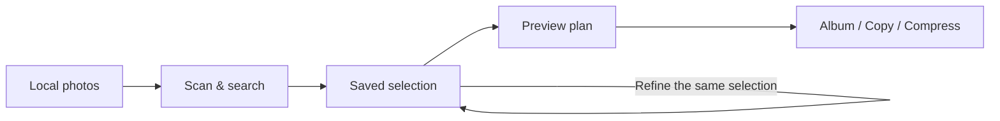

<div align="center">


# Photo Organizer

**Give your agent the tools to find, group, and export your photos.**

Local photo organization · Persistent selections · Preview before export

[](pyproject.toml)
[](LICENSE)
[](docs/DELIVERY.md)

[Quick start](#quick-start) · [Connect your agent](#connect-your-agent) · [Tool reference](skills/photo-organizer/references/tools.md) · [Roadmap](docs/PRD.md)

English · [简体中文](README.zh-CN.md)

</div>

---

Turn a folder of photos into a selection you can refine, a plan you can inspect,
and an organized export. Photo Organizer gives tool-capable agents a shared local
engine through a **Skill**, **MCP server**, or **JSON CLI**. Originals stay in place.

> “Find the landscape photos, group them by month, and copy them into a new folder.”
>
> “From that selection, keep only the photos from 2024.”
>
> “Export smaller JPEG copies of these photos for sharing.”

These are example requests for a connected agent. The agent interprets your request;
the engine handles selections, plans, and file operations.



> [!NOTE]
> **Development alpha.** Install from source; there is no package registry release yet.
> See [delivery status](docs/DELIVERY.md) for validation evidence and remaining release gates.

## Why Photo Organizer?

| What you need | How it works |
| --- | --- |
| **Keep working with “those photos”** | Persistent result IDs retain the selection across turns and restarts. Further filters stay inside that selection. |
| **Check the result before exporting** | Search, planning, and execution are separate steps. Inspect groups and counts before applying a plan. |
| **Keep your originals** | Create albums, copy files, or export compressed JPEGs. Source files are preserved; existing destinations are never overwritten. |
| **Use it from your preferred agent** | The Skill, local stdio MCP server, and CLI share the same engine and state directory. |
| **Start without a model** | Metadata search and export need no API key or model download. Add visual analysis and retrieval when needed. |
| **Know what a result means** | Ranked visual candidates stay distinct from evidence-backed matches. Missing tags do not prove that a subject is absent. |

## Quick start

**Requirements:** Python 3.11+, macOS or Linux with POSIX file APIs.
Local test evidence is currently from macOS; Linux CI is configured, with remote
acceptance still pending. Windows is unsupported.

### 1. Install from source

```sh
git clone https://github.com/berhannnnd/photo-organizer.git
cd photo-organizer
python3 -m venv .venv
. .venv/bin/activate
python -m pip install '.[mcp]'
```

For CLI-only use, install with `python -m pip install .`. The core depends on Pillow;
the `mcp` extra adds the official MCP Python SDK.

### 2. Scan and select

Replace the absolute paths below with your own. Keep the state directory outside
your photo folders and this checkout, and reuse it across sessions.

```sh
photo-organizer --state /absolute/library-state call capabilities
photo-organizer --state /absolute/library-state call scan --args '{"root":"/absolute/photos"}'
photo-organizer --state /absolute/library-state call search --args '{"rule":{"orientation":"landscape"}}'
```

The search response includes `data.result_set_id`. Use that value as `RESULT_ID` below.

### 3. Preview, then export

```sh
photo-organizer --state /absolute/library-state call plan --args '{"spec":{"result_set_id":"RESULT_ID","group_by":"month"},"mode":"copy","target":"/absolute/organized"}'
```

Inspect the returned groups, selected count, and mode. Use the returned `data.plan_id`
as `PLAN_ID`, then execute within the user's authorization:

```sh
photo-organizer --state /absolute/library-state call apply --args '{"plan_id":"PLAN_ID"}'
```

Photos without an EXIF capture date go into `date-unknown`; download times are not
used as capture dates. The output directory must not overlap any source root.
Read `status`, `error`, and per-action errors—partial failure is not a completed export.

## Connect your agent

| Interface | Best for | Start here |
| --- | --- | --- |
| **Skill** | Teaching an agent the search → refine → plan → apply workflow | [Portable Skill](skills/photo-organizer/SKILL.md) |
| **MCP** | Agents that support local stdio tool servers | Configuration below |
| **CLI** | Shell workflows and integrations that consume JSON | [Tool reference](skills/photo-organizer/references/tools.md) |

Install or reference the Skill using your host's Skill mechanism. It is also bundled
under `share/photo-organizer/skills/photo-organizer` relative to the installation prefix.

For an MCP host, adapt its configuration to launch the installed executable:

```json
{
  "mcpServers": {
    "photo-organizer": {
      "command": "/absolute/photo-organizer/.venv/bin/photo-organizer-mcp",
      "args": ["--state", "/absolute/library-state"]
    }
  }
}
```

Replace both paths. Use the **same state directory** for the CLI and MCP server.
Start with `photo_capabilities` to discover the installed engine's supported operations.

The server runs with your local user permissions. Connect it to trusted hosts and
use authorized directories; the host controls tool authorization. It is a local
process, not a remote multi-tenant service.

## Add visual search when you need it

The metadata workflow above works without a model. Visual features require their
own configuration and index coverage:

| Capability | Setup | Result |
| --- | --- | --- |
| Visual descriptions and tags | An explicitly configured image-capable provider | Indexed observations that can be searched and reviewed |
| Image/text retrieval | A compatible local Ollama model and `call embed-index` | Ranked candidates stored as a reusable result set |
| Description retrieval | Visual observations plus `call describe-index` | An additional retrieval channel when coverage permits |

<details>
<summary><strong>Configure visual indexing</strong></summary>

Copy [the provider example](examples/provider.json) outside the repository. Set the
exact model, endpoint, and named API-key environment variable, then start with a
small authorized batch:

```sh
photo-organizer --state /absolute/library-state index --config /absolute/provider.json --limit 5
```

This sends derived images to the configured provider. The alpha supports
Anthropic-compatible image requests. Credentials belong in the named environment
variable, not in the repository. CC Switch import is optional legacy functionality.

For local retrieval, see the [Ollama probe notes](docs/local-ollama.md) for the tested
model and evidence scope, and the [tool reference](skills/photo-organizer/references/tools.md)
for index and retrieval operations. Models are not downloaded automatically.

Ranked candidates are not verified matches. Review them before claiming semantic
accuracy, or explicitly choose to organize the candidate set.

</details>

## Project status and documentation

Photo Organizer is under active development. The [PRD](docs/PRD.md) defines the
complete product target; the [delivery checklist](docs/DELIVERY.md) tracks release
requirements. Discover runtime capabilities before relying on a feature. Local tests
and small model probes do not establish full-library quality or cross-host readiness.

| Document | What you will find |
| --- | --- |
| [Tool reference](skills/photo-organizer/references/tools.md) | Commands, filters, grouping, selection, and evidence contracts |
| [Portable Skill](skills/photo-organizer/SKILL.md) | Agent workflow and execution guidance |
| [Product roadmap / PRD](docs/PRD.md) | Target capabilities and acceptance requirements |
| [Delivery status](docs/DELIVERY.md) | Recorded validation and remaining release gates |
| [Changelog](CHANGELOG.md) | Changes between versions |
| [Contributing](CONTRIBUTING.md) | Development conventions and validation expectations |

## Contributing

Bug reports, reproducible examples, documentation improvements, and code contributions
are welcome. Start with [CONTRIBUTING.md](CONTRIBUTING.md), or
[open an issue](https://github.com/berhannnnd/photo-organizer/issues).

```sh
python -m pip install '.[mcp,dev]'
python -m unittest discover -s tests -v
python -m build
```

## License

Code is licensed under [MIT](LICENSE). Photo datasets retain their original source
licenses. The local 1,000-photo development dataset is not bundled or relicensed by
this project.
