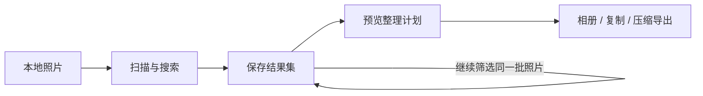

<div align="center">


# Photo Organizer

**让你的智能体帮你找照片、分组，并整理导出。**

本地照片整理 · 可持续筛选的结果集 · 先预览，再导出

[](pyproject.toml)
[](LICENSE)
[](docs/DELIVERY.md)

[快速开始](#快速开始) · [接入智能体](#接入智能体) · [工具文档](skills/photo-organizer/references/tools.md) · [路线图](docs/PRD.md)

[English](README.md) · 简体中文

</div>

---

从一堆照片，到可以继续筛选的结果集，再到可检查的整理计划和导出文件。
Photo Organizer 通过 **Skill、MCP 服务和 JSON CLI**，为支持工具调用的智能体提供同一个本地整理引擎。原图保留在原处。

> “找出横向照片，按月份分组，复制到一个新目录。”
>
> “从刚才那些照片里，只保留 2024 年拍的。”
>
> “把这些照片导出成小一些的 JPEG，方便分享。”

以上是接入智能体后的示例请求：智能体理解你的意图，引擎负责筛选、生成计划和执行文件操作。



> [!NOTE]
> **当前为开发中的 Alpha 版本。** 需从源码安装，尚未发布到包仓库。
> 已有验证记录和发布前待办见[交付状态](docs/DELIVERY.md)。

## 为什么使用 Photo Organizer？

| 你想做的事 | 引擎如何支持 |
| --- | --- |
| **继续整理“刚才那些照片”** | 结果集有持久化 ID，跨轮次、重启后仍可复用；后续筛选限定在原有选择内。 |
| **先检查，再导出** | 搜索、计划和执行分开进行，先查看分组及数量，再应用计划。 |
| **保留原图** | 支持创建相册、复制和压缩为 JPEG；不修改源文件，不覆盖已有目标文件。 |
| **从熟悉的智能体操作** | Skill、stdio MCP 和 CLI 共享同一套引擎及状态目录。 |
| **不配模型也能开始** | 元数据筛选和导出无需 API Key 或模型下载，需要时再接入视觉分析与检索。 |
| **看清结果的依据** | 区分相似度检索候选与有证据的匹配；缺少某个标签，不等于照片中没有该对象。 |

## 快速开始

**环境要求：** Python 3.11+，macOS 或支持 POSIX 文件 API 的 Linux。
目前本地测试证据来自 macOS；已配置 Linux CI，远程验收仍待完成。暂不支持 Windows。

### 1. 从源码安装

```sh
git clone https://github.com/berhannnnd/photo-organizer.git
cd photo-organizer
python3 -m venv .venv
. .venv/bin/activate
python -m pip install '.[mcp]'
```

仅使用 CLI 时，可改为 `python -m pip install .`。核心依赖 Pillow，`mcp` 扩展安装官方 MCP Python SDK。

### 2. 扫描并筛选

将下方绝对路径替换为自己的目录。状态目录放在照片目录及源码目录之外，并在后续会话中持续复用。

```sh
photo-organizer --state /absolute/library-state call capabilities
photo-organizer --state /absolute/library-state call scan --args '{"root":"/absolute/photos"}'
photo-organizer --state /absolute/library-state call search --args '{"rule":{"orientation":"landscape"}}'
```

搜索响应中的 `data.result_set_id` 就是本次结果集 ID，用它替换下一步的 `RESULT_ID`。

### 3. 预览，再导出

```sh
photo-organizer --state /absolute/library-state call plan --args '{"spec":{"result_set_id":"RESULT_ID","group_by":"month"},"mode":"copy","target":"/absolute/organized"}'
```

检查返回的分组、选中数量和执行模式。将 `data.plan_id` 替换到下面的 `PLAN_ID`，在用户授权范围内执行：

```sh
photo-organizer --state /absolute/library-state call apply --args '{"plan_id":"PLAN_ID"}'
```

没有 EXIF 拍摄日期的照片归入 `date-unknown`，不会用下载时间冒充拍摄时间。
输出目录不能与源目录重叠。检查 `status`、`error` 及各项执行错误；部分失败不能视作导出完成。

## 接入智能体

| 接入方式 | 适合的场景 | 入口 |
| --- | --- | --- |
| **Skill** | 让智能体掌握搜索 → 筛选 → 计划 → 执行的整理流程 | [可移植 Skill](skills/photo-organizer/SKILL.md) |
| **MCP** | 支持本地 stdio 工具服务的智能体 | 下方配置示例 |
| **CLI** | Shell 工作流与消费 JSON 的集成程序 | [工具文档](skills/photo-organizer/references/tools.md) |

按宿主的 Skill 机制安装或引用本项目 Skill。安装包也会将它放到安装前缀下的
`share/photo-organizer/skills/photo-organizer`。

MCP 宿主可参考以下配置启动已安装的可执行文件：

```json
{
  "mcpServers": {
    "photo-organizer": {
      "command": "/absolute/photo-organizer/.venv/bin/photo-organizer-mcp",
      "args": ["--state", "/absolute/library-state"]
    }
  }
}
```

替换两个绝对路径，CLI 与 MCP 使用**同一个状态目录**。先调用 `photo_capabilities`，发现当前安装版本实际支持的操作。

服务以本地用户权限运行。请连接受信任的宿主，并操作已获授权的目录；工具授权由宿主控制。
这是本地进程，不是远程多租户服务。

## 按需添加视觉搜索

上面的元数据整理流程无需模型。视觉能力需要独立配置，并建立相应索引：

| 能力 | 所需配置 | 得到什么 |
| --- | --- | --- |
| 图片描述与标签 | 显式配置支持图片输入的模型服务 | 可搜索、可复核的视觉观察记录 |
| 图文检索 | 兼容的本地 Ollama 模型，以及 `call embed-index` | 可复用的、按相关度排序的候选结果集 |
| 描述检索 | 已有视觉观察记录，以及 `call describe-index` | 覆盖范围满足条件时增加一路检索结果 |

<details>
<summary><strong>配置视觉索引</strong></summary>

将[模型配置示例](examples/provider.json)复制到仓库之外，指定准确的模型、服务地址和保存 API Key 的环境变量名。
从小批量、已授权的照片开始：

```sh
photo-organizer --state /absolute/library-state index --config /absolute/provider.json --limit 5
```

这会把派生图片发送给配置的模型服务。当前 Alpha 支持 Anthropic 兼容的图片请求。
凭据保存在指定环境变量中，不应提交到仓库。CC Switch 导入属于可选的历史兼容功能。

本地检索的已测试模型与证据范围见 [Ollama 验证记录](docs/local-ollama.md)，
索引及检索操作见[工具文档](skills/photo-organizer/references/tools.md)。引擎不会自动下载模型。

相似度候选不等于已确认匹配。应先复核语义条件，或明确选择直接整理这批候选。

</details>

## 项目状态与文档

项目仍在开发中。[PRD](docs/PRD.md)定义完整产品目标，[交付清单](docs/DELIVERY.md)记录发布要求。
使用功能前先发现运行时能力。本地测试和小样本模型验证，不代表已完成全库质量评估或跨宿主验收。

| 文档 | 内容 |
| --- | --- |
| [工具文档](skills/photo-organizer/references/tools.md) | 命令、筛选、分组、结果集与证据契约 |
| [可移植 Skill](skills/photo-organizer/SKILL.md) | 智能体的整理流程与执行指引 |
| [产品路线图 / PRD](docs/PRD.md) | 目标能力与验收要求 |
| [交付状态](docs/DELIVERY.md) | 已记录的验证与发布前待办 |
| [更新记录](CHANGELOG.md) | 版本变化 |
| [贡献指南](CONTRIBUTING.md) | 开发约定与验证要求 |

## 参与贡献

欢迎提交可复现的 Bug、改进文档或贡献代码。请先阅读[贡献指南](CONTRIBUTING.md)，
也可以[提交 Issue](https://github.com/berhannnnd/photo-organizer/issues)。

```sh
python -m pip install '.[mcp,dev]'
python -m unittest discover -s tests -v
python -m build
```

## 许可证

代码采用 [MIT 许可证](LICENSE)。照片数据保留各自的来源许可。
本地用于开发的 1,000 张照片不会随安装包分发，也不会因代码开源而改变授权。
